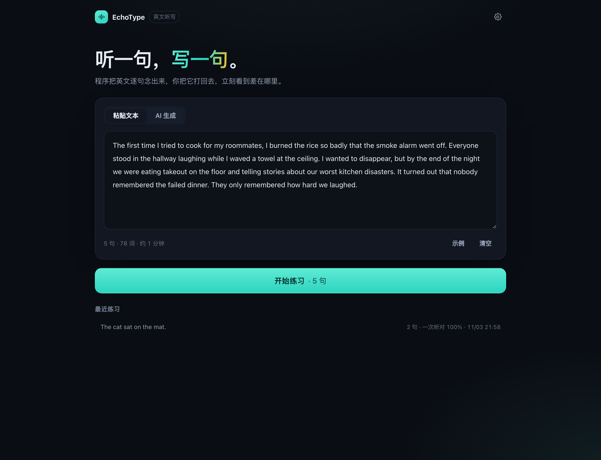
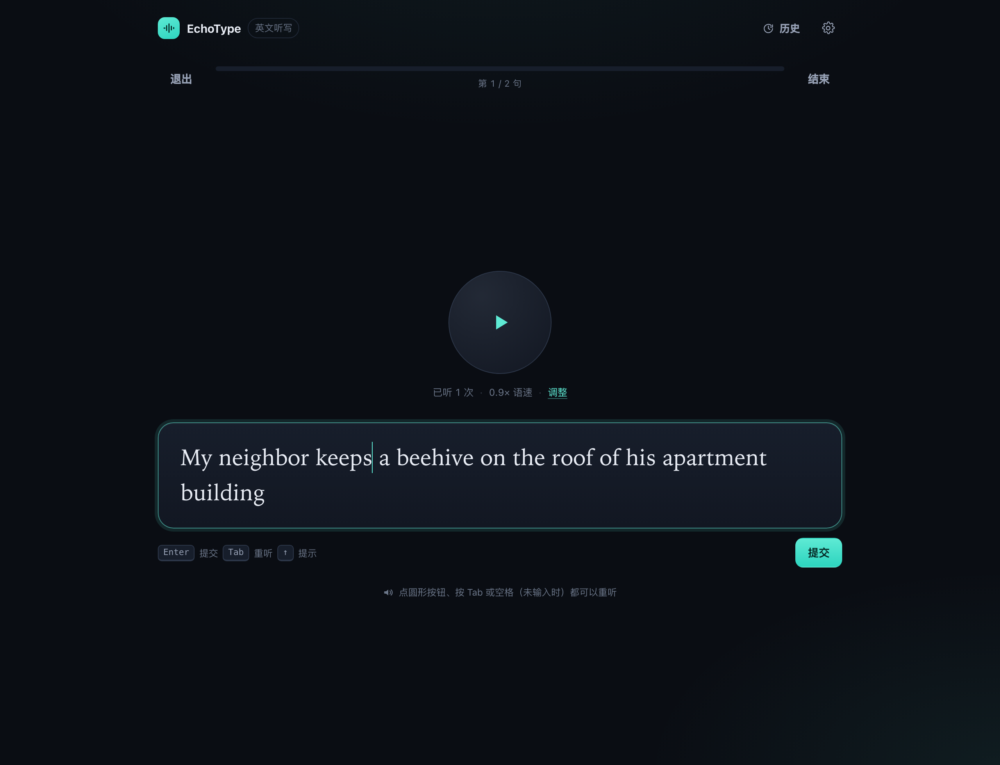
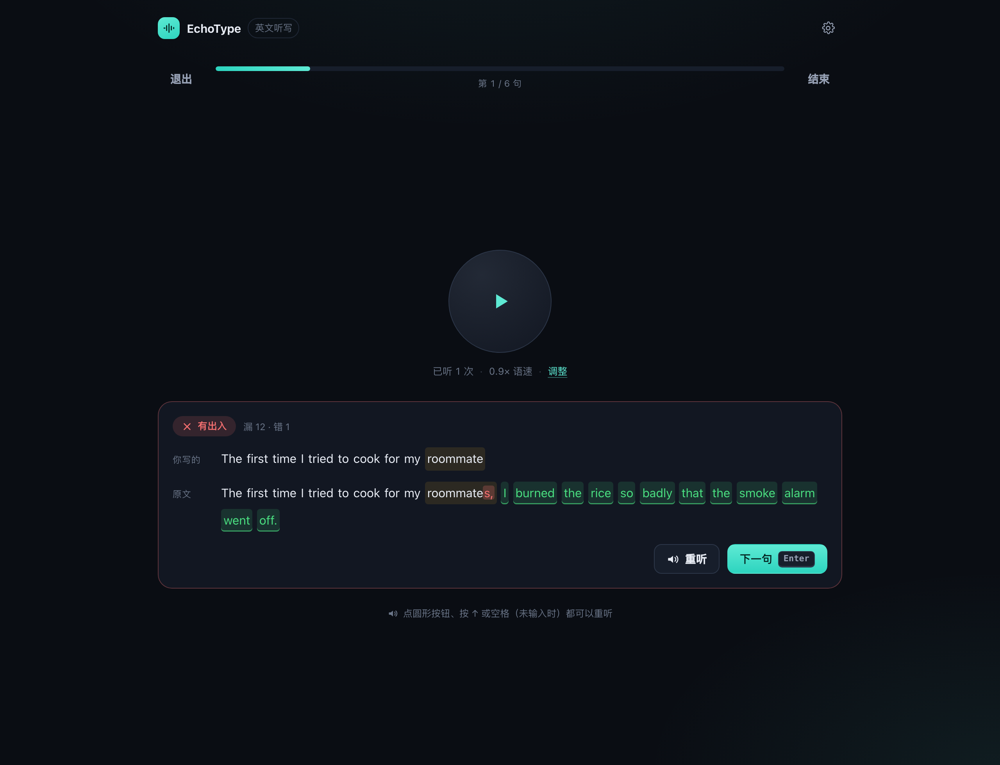
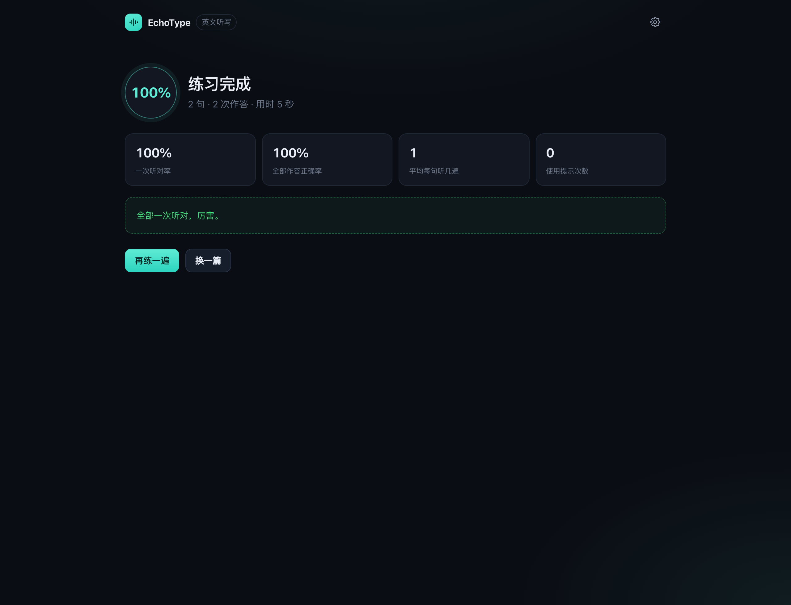
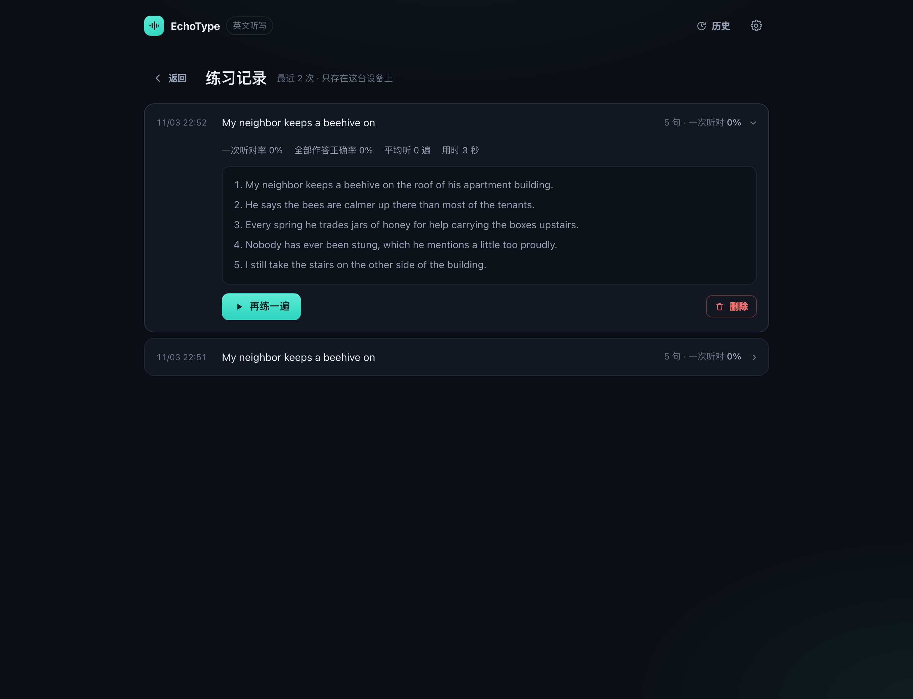

# EchoType — 英文听写练习

把一段英文变成「听一句、写一句」的练习：程序用浏览器原生的语音合成逐句朗读，
你把它打出来，立刻看到差在哪个词上。

零后端、纯本地。文本可以自己贴，也可以让本机跑的大模型现写。



## 快速开始

```bash
npm install
npm run dev        # http://127.0.0.1:5173
```

打开页面 → 粘贴一段英文（或点「示例」）→ 开始练习。
不需要任何 API key，语音用的是系统自带的英文 TTS。

> 浏览器建议用 Chrome / Edge / Safari。Firefox 的 `speechSynthesis` 声音质量较差。

## 在线版

<https://limengke123.github.io/echotype/>

由 `.github/workflows/deploy.yml` 自动发布：push 到 `main` → 跑测试 → 构建（base 为 `/echotype/`）→ 部署到 GitHub Pages。

> 仓库首次发布需要在 **Settings → Pages → Build and deployment → Source** 里选 **GitHub Actions**，
> 之后每次 push 都会自动更新。

线上版没有 Vite 那个 `/llm` 代理，AI 生成会直连本机 `127.0.0.1:11434`，所以要让 Ollama 放行站点来源：

```bash
OLLAMA_ORIGINS=https://limengke123.github.io ollama serve
```

如果浏览器仍然拦下（部分版本的私有网络策略会阻止 HTTPS 页面访问本机端口），
用本地 `npm run dev` 打开即可——本地走内置代理，最稳。

## 功能

**输入端**

- **粘贴文本** —— 自动清洗 markdown、重新拼接被硬换行截断的句子，再按标点切句。
  缩写（`Mr.` / `e.g.` / `U.S.`）、小数（`3.14`）、引号收尾都不会被误切。
- **AI 生成** —— 选题材 / CEFR 难度 / 句数 / 目标词，让本地大模型写**一篇连贯短文**：
  同一个场景、同一批人物，句子之间用指代和连接词串起来，而不是互不相关的一堆句子。
  生成时只显示进度（已收到多少字、约几句），**生成完正文默认藏起来**，想改再点「查看并编辑」。

**练习端**

- 逐句朗读，圆形按钮 / `Tab` / 空格重听，显示已听次数
- 实时语速调节（0.6×–1.2×）；音色只列 Chrome 自带的 Google 英文音色，默认 Google 美音，可试听
- 输入区是「一个字母一个格子」的大字号输入面板，自动聚焦；点圆形按钮、点「调整」、
  点页面空白处都不会丢焦点，回到输入框直接能继续打
- 打字提交后做**词级 diff + 字符级高亮**：漏掉的词、多打的词、拼错的字母分别标出来
- 三档判定：宽松（忽略大小写和标点）/ 标准 / 严格
- 答对自动进入下一句；答错可以重听、重练
- **错句回炉**：本轮答错的句子会在结束前再考一次
- 结束页：一次听对率、总正确率、平均每句听几遍、用时、错句清单（可单独朗读）
- 「只练错的 N 句」一键生成一轮新练习
- **练习记录**：本地保留最近 30 次，点「历史」能翻出之前练过的文本，看当时哪几句错了，
  并且一键「再练一遍」或「只练错的」

**快捷键**

| 键 | 作用 |
| --- | --- |
| `Enter` | 提交答案 / 进入下一句 |
| `Tab` | 重听当前句 |
| `↑` | 提示：先给词数，再给每个词的首字母 |
| `空格` | 输入框为空时重听（避免干扰打字） |
| `Esc` | 停止朗读 |

## 界面









## 接本地大模型

### Ollama（默认，推荐）

```bash
ollama pull qwen2.5:7b      # 或 llama3.1:8b、qwen2.5:14b……
ollama serve
```

打开页面右上角 ⚙️ →「本地大模型」：

- **Base URL 留空** —— 走 Vite 内置代理 `/llm` → `http://127.0.0.1:11434`，
  浏览器不会触发 CORS，Ollama 也不用额外配置。
- **模型** 填 `qwen2.5:7b`，点「检测」可以列出本机已有的模型。

代理目标可以用环境变量改：

```bash
ECHOTYPE_OLLAMA_URL=http://127.0.0.1:11434 npm run dev
```

### LM Studio / llama.cpp / vLLM 等 OpenAI 兼容服务

把 Base URL 填成完整地址即可直连，例如 `http://127.0.0.1:1234/v1`，
模型名照抄服务端加载的那个。需要鉴权就填 API Key。

> ⚠️ 直连时如果浏览器报 CORS 错误，说明对方没有放行页面来源。
> 对 Ollama 可以 `OLLAMA_ORIGINS=http://127.0.0.1:5173 ollama serve`，
> 或者干脆留空 Base URL 用内置代理。

### 排错

| 现象 | 原因 / 处理 |
| --- | --- |
| `本地 Ollama（127.0.0.1:11434）没有响应` | 服务没起，先 `ollama serve` |
| `这个模型只输出了「思考过程」，没有正文` | 模型把正文写进了 `reasoning` 且内容像思考笔记。换 `qwen2.5:7b`、`llama3.1:8b` 这类普通指令模型 |
| `404` | Base URL 填错。Ollama 走内置代理时留空；LM Studio 形如 `http://127.0.0.1:1234/v1` |
| 模型名报错 | 点设置里的「检测」看看本机到底装了哪些 |

### 关于 `reasoning` 通道

有些模型（Ollama 里的 MLX 模型很典型）会把正文写进 `reasoning` 字段、把 `content` 留空。
App 会把这段文本直接当作结果用——只要它不像「思考笔记」（`Let me think…`、`Here are the sentences…`、
`Task:` 之类）。真的只吐思考过程时才会报错。

生成期间按钮上会显示已等待的秒数，这类模型通常要等整段生成完才一次性出现。

## 判定规则

| 档位 | 行为 |
| --- | --- |
| 宽松（默认） | 忽略大小写、标点、多余空格，`don't` 与 `dont` 等价 |
| 标准 | 忽略大小写，标点必须一致 |
| 严格 | 大小写和标点都要一致（弯引号、破折号等排版字符会被归一化） |

## 数据

- 设置与最近 30 次练习记录存在 `localStorage`（`echotype.settings.v1` / `echotype.sessions.v1`）
- 没有任何网络请求，除非你主动点「生成文本」；此时只请求你配置的那个本地地址
- 「设置 → 数据 → 清除记录」可以一键清空

## 项目结构

```
src/
├── App.tsx                 三个界面的切换：设置页 → 练习页 → 成绩页
├── lib/
│   ├── splitter.ts         文本清洗 + 按句子切分（缩写、小数、md 语法）
│   ├── grading.ts          三档判定归一化 + 提示生成
│   ├── diff.ts             词级 LCS diff + 字符级高亮
│   ├── prompts.ts          出题 prompt 与模型输出解析
│   ├── llm.ts              OpenAI 兼容流式客户端（含 Ollama 代理与模型列表）
│   ├── stats.ts            成绩统计
│   ├── storage.ts          设置 / 练习记录持久化
│   └── types.ts            领域类型
├── hooks/
│   ├── useSpeaker.ts       Web Speech API 封装（voice 异步加载、Chrome 的 cancel 竞态）
│   ├── useDictation.ts     练习状态机：队列、回炉、判定、进度
│   └── useSettings.ts      设置读写
└── components/             界面

scripts/test-core.ts        逻辑层自测（切分 / 判定 / diff / 统计）
docs/                      截图
```

> `lib/` 里的运行时 import 带 `.ts` 后缀，这样 `node scripts/test-core.ts` 能直接跑
> （Node 22 原生类型擦除），不需要给测试再装一套 bundler。

## 开发

```bash
npm run build      # tsc 类型检查 + 产物
npm run preview    # 预览产物（同样带 /llm 代理）
npm run test:core  # 逻辑层自测（切分 / 判定 / diff / 统计）
```

## 已知限制

- 语音只用 Chrome 自带的 Google 英文音色（`Google US English`、`Google UK English Female/Male`），
  它们走网络合成，断网时会退回系统默认发音。其他浏览器可能一个 Google 音色都没有。
- 一个句子对应一次听写。超过 190 字符的长句会在分号/逗号处再切一刀。
- `speechSynthesis` 需要用户先有一次交互，页面里点「开始练习」即满足要求。
